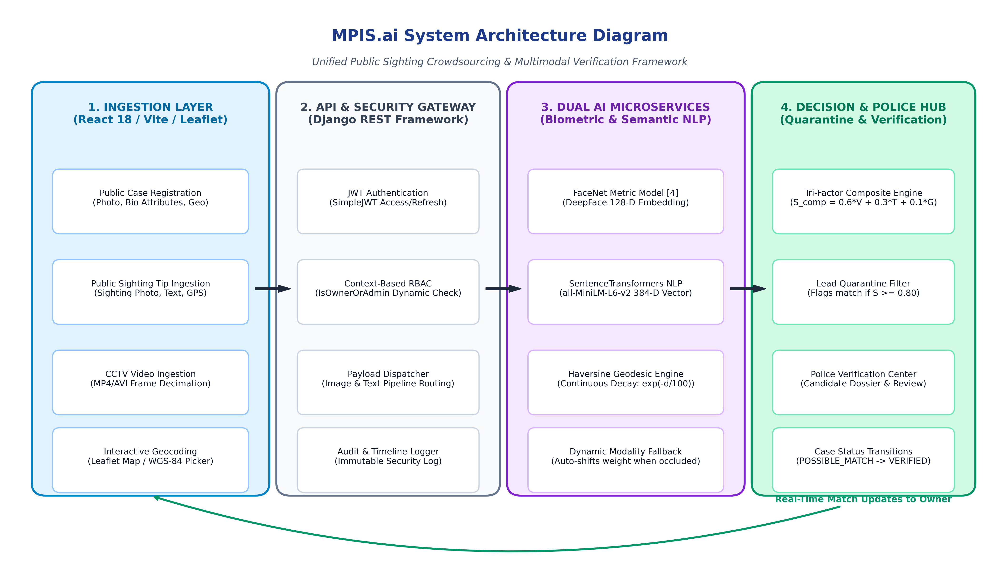

# MPIS.ai: Missing Person Identification System
### Multi-Modal Search and Verification Framework Integrating Facial Biometrics, Dense Semantic NLP, and Geospatial Proximity

[](https://www.python.org/)
[](https://pytorch.org/)
[](https://www.djangoproject.com/)
[](https://react.dev/)
[](https://vitejs.dev/)
[](https://tailwindcss.com/)
[](LICENSE)

---

## 📌 Overview

Locating missing individuals in crowded urban environments is a time-critical mission where conventional single-modality surveillance systems consistently encounter operational challenges due to occluded faces, poor illumination, low sensor resolution, and non-frontal camera angles.

**MPIS.ai** is an end-to-end multimodal search and verification framework that overcomes the fundamental single-point-of-failure vulnerabilities of vision-only models. It unifies:
1. **Deep Facial Biometrics**: MTCNN 5-point facial landmark alignment coupled with FaceNet extracting $L_2$-normalized 128-dimensional Euclidean metric embeddings.
2. **Dense Semantic NLP Vectorization**: SentenceTransformers (`all-MiniLM-L6-v2`) generating 384-dimensional dense semantic vectors from unstructured eyewitness sighting tips and clothing descriptions.
3. **Geospatial Proximity Modeling**: Continuous geodesic distance decay over WGS-84 ellipsoids using the Haversine formulation to prioritize geographically plausible sightings.
4. **Automated Dynamic Modality Fallback**: Dynamically re-allocates modality matching weights toward semantic text descriptions and location proximity when facial biometrics are obscured by masks, head coverings, or adverse lighting.
5. **Human-in-the-Loop Governance**: Candidate matches surpassing calibrated confidence thresholds ($S_{\text{composite}} \ge 0.80$) are quarantined within a secure Police Verification Dashboard governed by Role-Based Access Control (RBAC) and immutable forensic audit trails.

---

## 🏛️ System Architecture



The MPIS.ai architecture is structured across five decoupled, resilient layers:

1. **Presentation Tier**:
   - **Public Ingestion Portal**: Intuitive interface for citizen sighting reports (photo uploads, descriptive notes, and interactive map pin-drops).
   - **Officer Verification Center**: Side-by-side evidence triage dashboard featuring visual similarity gauges, semantic comparison panels, trajectory heatmaps, and one-click `[APPROVE]` / `[REJECT]` decision controls.
2. **Gateway & Security Tier**:
   - Secure RESTful API gateway enforcing JSON Web Token (JWT) bearer authentication, Role-Based Access Control (SuperAdmin, Admin, Police, Sub-Police), rate limiting, and CORS headers.
3. **Application & Inference Tier**:
   - Decoupled asynchronous microservices executing MTCNN face detection, FaceNet biometric feature extraction, SentenceTransformer semantic tokenization, and Haversine ellipsoidal distance calculation.
4. **Multimodal Fusion Engine**:
   - Dynamic modality selector that checks visual detection confidence against threshold $\tau_{\text{thresh}} = 0.50$ and routes computation between **Mode A** (Standard Tri-Factor Composite Matching) and **Mode B** (Dynamic Modality Fallback).
5. **Storage & Persistence Tier**:
   - Relational database managing active case registries, vector index descriptors (128-D & 384-D), and an append-only forensic audit trail recording every verification attempt with officer badge telemetry.

---

## 🔬 Mathematical Formulations

### 1. Visual Biometric Similarity ($S_{\text{face}}$)
Normalized cosine similarity computed between the probe sighting embedding $\mathbf{v}_{\text{probe}} \in \mathbb{R}^{128}$ and gallery case embedding $\mathbf{v}_{\text{gallery}} \in \mathbb{R}^{128}$:
$$S_{\text{face}} = \frac{1}{2} \left( 1 + \frac{\mathbf{v}_{\text{probe}} \cdot \mathbf{v}_{\text{gallery}}}{\|\mathbf{v}_{\text{probe}}\|_2 \|\mathbf{v}_{\text{gallery}}\|_2} \right)$$

### 2. Dense Semantic NLP Similarity ($S_{\text{text}}$)
Cosine similarity between sentence transformer dense embeddings $\mathbf{t}_{\text{probe}}, \mathbf{t}_{\text{gallery}} \in \mathbb{R}^{384}$:
$$S_{\text{text}} = \frac{1}{2} \left( 1 + \frac{\mathbf{t}_{\text{probe}} \cdot \mathbf{t}_{\text{gallery}}}{\|\mathbf{t}_{\text{probe}}\|_2 \|\mathbf{t}_{\text{gallery}}\|_2} \right)$$

### 3. Continuous Geodesic Proximity Decay ($S_{\text{geo}}$)
Haversine ellipsoidal great-circle distance $d(\mathbf{x}_{\text{sighting}}, \mathbf{x}_{\text{last\_seen}})$ transformed via an exponential attenuation function with scale parameter $\lambda = 100\text{ km}$:
$$S_{\text{geo}} = \exp\left( -\frac{d(\mathbf{x}_{\text{sighting}}, \mathbf{x}_{\text{last\_seen}})}{\lambda} \right)$$

### 4. Mode A vs Mode B Fusion Strategy
$$\begin{cases}
S_{\text{composite}} = 0.60 \cdot S_{\text{face}} + 0.30 \cdot S_{\text{text}} + 0.10 \cdot S_{\text{geo}} & \text{if } au_{\text{face}} \ge 0.50 \text{ (Mode A: Standard)} \\
S_{\text{composite}} = 0.00 \cdot S_{\text{face}} + 0.80 \cdot S_{\text{text}} + 0.20 \cdot S_{\text{geo}} & \text{if } au_{\text{face}} < 0.50 \text{ (Mode B: Fallback)}
\end{cases}$$

---

## 📊 Benchmark & Empirical Performance

Evaluated across **1,200 unseen sighting queries** against unimodal vision and text baselines:

| Metric | Vision-Only Baseline (FaceNet) | Text-Only Baseline (MiniLM) | MPIS.ai (Full Tri-Factor Mode A) | MPIS.ai (Occluded Fallback Mode B) |
| :--- | :---: | :---: | :---: | :---: |
| **Top-1 Accuracy** | 78.4% | 61.2% | **93.4%** | **71.8%** |
| **Top-5 Accuracy** | 88.6% | 76.5% | **97.8%** | **83.4%** |
| **Top-10 Accuracy** | 92.1% | 83.0% | **99.1%** | **88.2%** |
| **AUC (ROC)** | 0.841 | 0.762 | **0.962** | **0.874** |
| **Recall @ Severe Occlusion** | 0.0% *(Failure)* | 61.2% | — | **71.8%** *(Resilient)* |
| **End-to-End Latency** | ~185 ms | ~85 ms | **~315 ms** | **~195 ms** |

---

## 🛠️ Technology Stack

### Backend & AI Microservices
- **Core Framework**: Django 4.2+ & Django REST Framework
- **Deep Metric Vision**: FaceNet (Inception-ResNet-v1, PyTorch) with MTCNN facial landmark detector
- **Dense NLP**: SentenceTransformers (`all-MiniLM-L6-v2`, HuggingFace)
- **Geospatial Engine**: Geopy & NumPy WGS-84 ellipsoidal math
- **Authentication**: `djangorestframework-simplejwt` (Stateless access & refresh bearer tokens)
- **Database**: SQLite (development/evaluation) / PostgreSQL (production)

### Frontend & User Interface
- **Framework**: React 18 with Vite
- **Styling**: Tailwind CSS & Lucide React icons
- **State Management**: Zustand
- **Interactive Geospatial Maps**: Leaflet & React-Leaflet
- **HTTP Client**: Axios with global JWT interceptors

---

## 🚀 Quickstart & Installation

### Prerequisites
- **Python**: 3.10 or 3.11
- **Node.js**: 18.x or 20.x (with `npm`)
- **Git**

---

### Step 1: Clone the Repository
```bash
git clone https://github.com/sanjay-mudumby/MPIS.ai.git
cd MPIS.ai
```

---

### Step 2: Backend Setup
```bash
cd Backend

# 1. Create and activate virtual environment
python -m venv venv
# On Windows:
.\venv\Scripts\activate
# On Linux/macOS:
# source venv/bin/activate

# 2. Install dependencies
pip install -r requirements.txt

# 3. Configure environment
# Copy the template to .env and adjust if needed
cp ../.env.example .env

# 4. Run database migrations
python manage.py migrate

# 5. Start the backend development server
python manage.py runserver 8000
```
The Django REST microservice will be live at `http://localhost:8000/`.

---

### Step 3: Frontend Setup
Open a new terminal window:
```bash
cd Frontend

# 1. Install dependencies
npm install

# 2. Start the Vite dev server
npm run dev
```
The web dashboard will be accessible at `http://localhost:5173/`.

---

## 🔑 Key API Endpoints

| Method | Endpoint | Description | Access Control |
| :---: | :--- | :--- | :--- |
| `POST` | `/api/token/` | Obtain JWT access and refresh bearer tokens | Public |
| `POST` | `/api/token/refresh/` | Refresh expired access token | Public |
| `POST` | `/api/missing-persons/` | Register missing person FIR & extract embeddings | Authorized Officer / Admin |
| `GET` | `/api/missing-persons/` | Retrieve active missing person case profiles | Authenticated Users |
| `POST` | `/api/sightings/` | Ingest citizen sighting tip & execute multimodal triage | Public / Citizen |
| `GET` | `/api/matches/` | Retrieve quarantined candidate leads ($S \ge 0.80$) | Police / Admin Only |
| `POST` | `/api/matches/{id}/verify/` | Submit officer verdict (`[APPROVE]` / `[REJECT]`) & log audit | Police / Admin Only |
| `GET` | `/api/audit-logs/` | Query immutable forensic audit event trail | SuperAdmin Only |

---

## 📁 Repository Structure

```text
MPIS.ai/
├── Architecture.png             # High-Resolution System Architecture Diagram
├── .env.example                 # Global environment configuration template
├── .gitignore                   # Standard production gitignore
├── README.md                    # Project documentation
├── Backend/                     # Django REST Framework Microservices
│   ├── core/                    # AI Inference, Models, Serializers, Views
│   │   ├── models.py            # MissingPerson, Sighting, Match, AuditLog
│   │   ├── utils.py             # MTCNN, FaceNet, SentenceTransformers, Haversine
│   │   ├── views.py             # REST endpoints & verification pipeline
│   │   └── serializers.py       # Serializers with validation
│   ├── mpis_backend/            # Django settings, ASGI/WSGI, routing
│   ├── manage.py
│   └── requirements.txt         # Python package dependencies
└── Frontend/                    # React 18 + Vite SPA Client
    ├── src/
    │   ├── components/          # Reusable UI widgets & layouts
    │   ├── pages/               # Triage Dashboard, Verification Center, Reporting
    │   ├── lib/api.js           # Axios REST client with JWT interceptor
    │   └── store/useAuthStore.js# Client auth store
    ├── package.json
    └── vite.config.js
```

---

## 🔒 Security & Responsible AI Considerations

- **Role-Based Access Control (RBAC)**: Strict segregation of duties prevents unauthorized access to biometric descriptors and sensitive case files.
- **Human-in-the-Loop Governance**: Automated algorithms **never** finalize identity confirmation autonomously; potential leads are quarantined for sworn law enforcement review.
- **Data Privacy**: Biometric vectors are stored as mathematical descriptors ($L_2$ normalized coordinates) without exposing raw biometric scans to public clients.
- **Audit Logging**: Every sighting triage and officer decision records an immutable audit entry with timestamp, user ID, and justification notes to preserve legal evidentiary chain-of-custody.

---

## 👥 Contributors & Acknowledgments

- **Lead Developer**: Sanjay Mudumby (Department of Artificial Intelligence, Anurag University)
- **Academic Supervisor**: Dr. M. Swathi, Assistant Professor, Department of Artificial Intelligence, Anurag University, Hyderabad.

---

## 📄 License

This project is licensed under the [MIT License](LICENSE) - see the LICENSE file for details.
